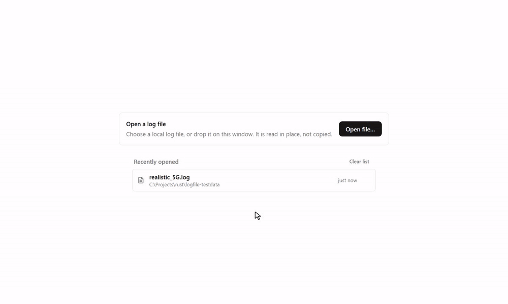

# Logfile Processor

[](https://github.com/cal-jsh/logfile-processor/actions/workflows/rust.yml)
[](LICENSE)

A fast log viewer for Windows and Linux, for files of many gigabytes. Open a log in place, filter it
by level, domain, thread or keyword, and see where things happen across the whole file.



_A 5 GB, 52 million line log: rows on screen in under a second, filters in a fraction of a second._

## Features

- **Any size.** Files are memory-mapped and indexed in parallel, never copied or loaded
  into memory. Scrolling and filtering stay fast at tens of GB.
- **Filters.** Log levels, domains, threads (or any other field of the line format)
  and keywords, with context lines around each match. Search and go to line with
  Ctrl+F / Ctrl+G.
- **Log formats.** spdlog-style formats are detected automatically (timestamp, level,
  logger, thread id or name). Anything else can be described with a pattern in the
  Log format page of Settings, with a live preview.
- **Minimap.** Where levels or domains occur across the file, by line or by time. Click
  to jump.
- **Thread lanes.** One lane per thread (or domain) over time, coloured by level.
  Ctrl+wheel to zoom, click to jump to the line.
- **Export.** The current view as text or CSV.
- **Light and dark.** Follows the Windows setting, or pick Light or Dark in Settings
  (sidebar footer, Ctrl+,). The window comes back where you left it (size, position, maximized),
  along with the layout: open panels, minimap and lanes settings, hidden columns.
- **Command line.** Open files from a terminal, or filter without a window
  (see below).
- **Recent files**, drag and drop onto the window or the exe (Windows) or "Open
  with" in the file manager (Linux), and a Report a bug button that fills in version
  details.

### Keyboard shortcuts

The sidebar and the filter panel start collapsed so the log gets the whole window.
Both remember whether you left them open.

| Keys | Action |
| --- | --- |
| Ctrl+→ / Ctrl+← | Show / hide the sidebar (also the toggle at its top, or Ctrl+B) |
| Ctrl+↓ / Ctrl+↑ | Show / hide the filter panel (also the Filter button in the status bar) |
| Ctrl+F / Ctrl+G | Search in the view / go to line |
| Ctrl+wheel | Zoom the thread lanes |
| Ctrl+, | Settings (theme, log format) |

The panel shortcuts are ignored while typing in a text field, where Ctrl+arrows move
the cursor by word. Filters stay applied while the panel is hidden; the status bar
shows them and has a button to clear them.

## Install

Download from the [latest release](https://github.com/cal-jsh/logfile-processor/releases/latest):

- **Windows 10 or 11:** the installer (`-setup.exe` or `.msi`). WebView2 is installed
  with the app if missing.
- **Debian, Ubuntu and derivatives (x86_64):** the `.deb`, installed with
  `sudo apt install ./Logfile.Processor_x.y.z_amd64.deb`. It pulls in WebKitGTK and
  puts `logfile_processor_desktop` (the viewer, also in the applications menu) and
  `logfile_processor_cli` in `/usr/bin`.
- **Other Linux distributions (x86_64):** the `.AppImage`. Make it executable
  (`chmod +x Logfile.Processor_x.y.z_amd64.AppImage`) and run it. It needs a system
  about as new as Ubuntu 22.04 or newer.

## Update

The app checks GitHub for a newer release when a window opens; the **Update** button
in the sidebar then reads "Update to x.y.z". It shows the release notes, downloads the
installer with a progress bar, checks its signature against the key built into the app,
and installs and restarts. Other open windows of the app close during the install.
Only published releases are offered, not drafts.

On Linux the AppImage replaces itself (the file must be writable by you); a `.deb`
install downloads the new `.deb` and installs it with `pkexec`, which asks for your
password.

## Command line

`logfile_processor_cli.exe` is installed next to the viewer (run it from the install
folder or add that folder to `PATH`). The Linux `.deb` installs `logfile_processor_cli`
in `/usr/bin`; for the AppImage, download `logfile_processor_cli-linux-x86_64.tar.gz`
from the release (the command line tool needs no WebKitGTK).

```powershell
# Open files, one window each
logfile_processor_cli app.log other.log

# Errors and criticals of two domains, 3 lines of context, in the terminal
logfile_processor_cli app.log -l error,critical -d net.http,net.tcp -C 3

# Lines mentioning timeout or refused, as CSV
logfile_processor_cli app.log -k timeout -k refused -o timeouts.csv
```

`-h` lists all options. Exit code 0 means ok (also when nothing matched), 1 a file
problem, 2 a bad option.

## Build from source

Needs Rust (stable), Node.js 22 and the
[Tauri prerequisites](https://v2.tauri.app/start/prerequisites/) for your system.
On Debian or Ubuntu that is:

```sh
sudo apt install build-essential curl file pkg-config libssl-dev libxdo-dev   libwebkit2gtk-4.1-dev libappindicator3-dev librsvg2-dev patchelf
```

From `frontend/`:

```powershell
npm install   # once
npm run desktop                  # dev run: Vite dev server + app window
npm run desktop:build            # release exe + installers for this system
```

The exe lands in `frontend/src-tauri/target/release/`, the installers (NSIS and MSI on
Windows, `.deb` and `.AppImage` on Linux) in `frontend/src-tauri/target/release/bundle/`.
In WSL, build inside the Linux file system (`~/...`), not under `/mnt/c`, which is
many times slower. Tests: `cargo test` in `backend/` and in
`frontend/src-tauri/`.

Releases are built by CI (a Windows and then a Linux job) from a `v*` tag that matches the version in
`frontend/src-tauri/tauri.conf.json`. `npm run set-version 1.2.3` (in `frontend/`) sets
that version in every file that carries it (tauri.conf.json, package.json, both
Cargo.toml files and the lock files); commit that, then tag the commit `v1.2.3`. Updater signing needs the repository secret
`TAURI_SIGNING_PRIVATE_KEY`; the matching public key is in `tauri.conf.json`.

## Project layout

| Path | Contents |
|---|---|
| `backend/` | Core library: memory-mapped index, log formats, filter engine, viewport API |
| `frontend/src/` | React UI |
| `frontend/src-tauri/` | Tauri shell, command line, console companion exe |
| `docs/` | [Architecture](docs/desktop-architecture-plan.md), demo GIF |

## License

[MIT](LICENSE)
