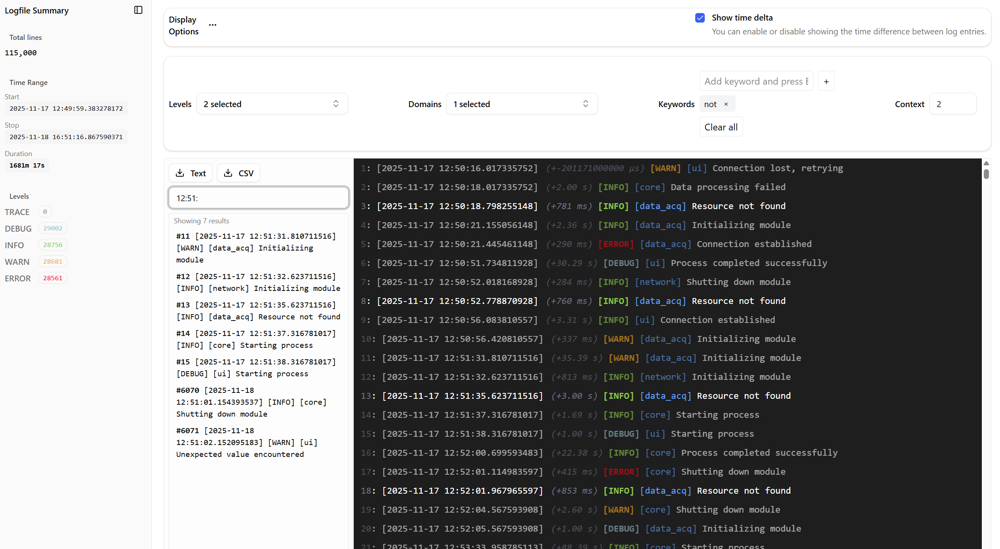

# Logfile Processor

Allows to search, filter and analyze log messages in the form of 
```terminal
[2025-11-17 12:50:00.763190172] [DEBUG] [network] Data received
[2025-11-17 12:50:03.763190172] [WARN] [network] Process completed successfully
[2025-11-17 12:50:04.153136172] [INFO] [core] Starting process
```

## Example



## Desktop app (Tauri 2)

The same React UI runs as a Windows desktop app. Log files are opened in place by
path (native "Open file" dialog, drag and drop, or a path on the command line) and
memory-mapped; nothing is uploaded or copied. The viewport API from `backend/` runs
inside the app on a random `127.0.0.1` port.

The Tauri shell is in `frontend/src-tauri`. From `frontend/`:

```shell
npm install --legacy-peer-deps   # once
npm run desktop                  # dev run: Vite dev server + app window
npm run desktop:build            # release exe + NSIS and MSI installers
```

The release exe is `frontend/src-tauri/target/release/logfile_processor_desktop.exe`,
the installers are under `frontend/src-tauri/target/release/bundle/`.

The web app is unchanged: run `cargo run` in `backend/` and `npm run dev` in `frontend/`.
